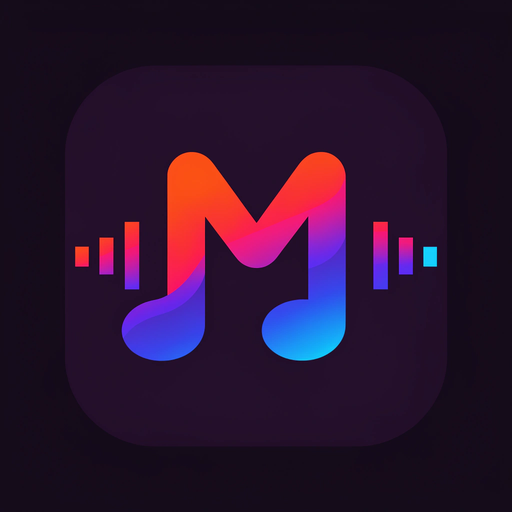

<div align="center">


# Melodix - **Feel Every Note**

Melodix is an open-source music player for Android with a minimal dark theme,
vibrant accents, Spotify integration and lossless playback support.

[](https://github.com/Cosm1cBug/Melodix/blob/main/LICENSE)

> ⚠️ Melodix is not affiliated with, funded, authorized, endorsed by, or in any
> way associated with YouTube, Google LLC, Spotify AB or Qobuz.

</div>

---

## Features

- 🎨 Minimal dark theme with vibrant violet / cyan / magenta accents
- 🎵 Play music from YouTube Music with a fast, modern player
- 🟢 **Spotify integration** — log in with your Spotify account and play your
  playlists, liked songs, top tracks and personalized recommendations
- ▶️ **YouTube Music account sync** — log in with Google to sync your YouTube
  playlists and likes into the library, with per-playlist sync selection
- 💎 **Qobuz lossless engine** — stream AAC 320 / CD / Hi-Res lossless quality
- 🎛️ Multiple player designs (classic and modern), sliders and themes
- 📝 Lyrics support with multiple providers
- ⏲️ Sleep timer, equalizer access, Android Auto support
- 📥 Downloads and offline playback
- 🎨 Dynamic theming, custom palettes and pure-black mode
- 🔒 No ads, no tracking — your music, your way

## Installation

1. Go to the [Releases](https://github.com/Cosm1cBug/Melodix/releases) page
2. Download the latest APK
3. Install and enjoy

## License

This project is licensed under the **GNU General Public License v3.0** —
see the [LICENSE](LICENSE) file for details.

```
Melodix — Feel Every Note
Copyright (C) 2026 Cosm1cBug

This program is free software: you can redistribute it and/or modify
it under the terms of the GNU General Public License as published by
the Free Software Foundation, either version 3 of the License, or
(at your option) any later version.

This program is distributed in the hope that it will be useful,
but WITHOUT ANY WARRANTY; without even the implied warranty of
MERCHANTABILITY or FITNESS FOR A PARTICULAR PURPOSE. See the
GNU General Public License for more details.
```

> **Note**: Melodix is an independent project and is not affiliated,
> sponsored, or endorsed by YouTube, Google or Spotify.
